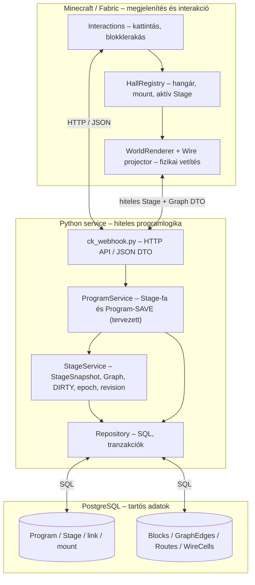
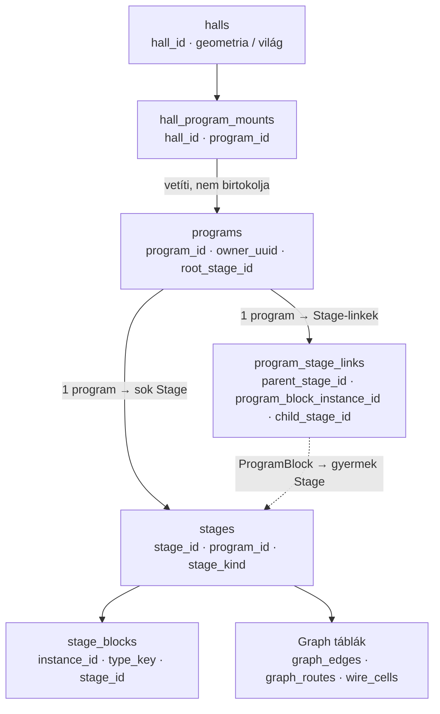
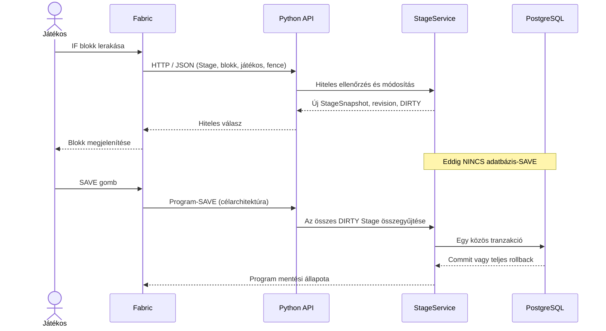
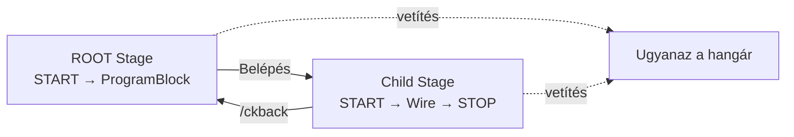
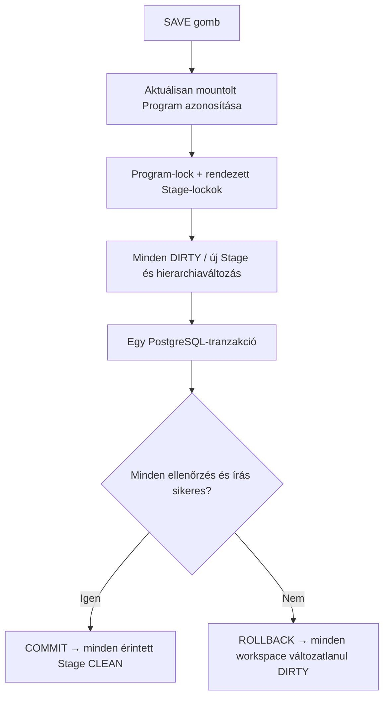

# bloCKommander – CK-06 architektúra, nagykockásan

> [!important] Jelenlegi állapot
> Ez a **CK-06 célarchitektúrája**, nem a már teljes egészében működő rendszer rajza. Az A1-munka a Program–Stage–Hangár adatmodell szétválasztását készíti elő / valósítja meg. A programszintű atomi SAVE, a ProgramBlock-navigáció és a kétfázisú Stage-váltás későbbi szeletek.

## 1. A három réteg

**Alapszabály:** a Minecraft **nem maga a program**, hanem annak szerkesztő- és megjelenítőfelülete. A Python birtokolja a domainlogikát és a munkapéldányokat; a PostgreSQL tárolja a mentett állapotot.

### Fabric (Kotlin)
- Érzékeli a játékos műveleteit és HTTP-kérést küld a Python szolgáltatásnak.
- Egy hangárban **egyszerre pontosan egy Stage** fizikai vetületét jeleníti meg.
- A Stage-váltáskor csak a vetített programblokkok és vezetékek változnak; a hangár épülete megmarad.
- A késői HTTP-válaszok ellen **epoch/revision** és tervezetten **switch-generation fencing** véd.
- Nem készítünk második, önálló Stage/Graph domainmotort Kotlinban.

### Python
- Ellenőrzi a jogosultságot, a Stage-et, a blokk típusát, a topológiát és a revíziót.
- Stage-enként külön **StageWorkspace** és **StageSnapshot** munkapéldányt tart memóriában.
- A módosítás **DIRTY** állapotot eredményez; ez még nem PostgreSQL-mentés.
- A tervezett **ProgramService** a Stage-fát és a programszintű mentést koordinálja.

### PostgreSQL
- A programok, Stage-ek, blokkok és gráfkapcsolatok **tartós** tárolója.
- A jelenlegi egy-Stage-es SAVE-ből a cél egy **teljes Programra kiterjedő atomi SAVE**.
- Python-restart után csak a már mentett adatok állíthatók biztosan helyre.

## 2. A cél-adatmodell

| Tábla | Felelősség |
|---|---|
| `programs` | A teljes program azonosítója, tulajdonosa, gyökér Stage-e |
| `stages` | Egy program önálló szerkesztési egységei |
| `program_stage_links` | ProgramBlock-példány és gyermek Stage kapcsolata |
| `stage_blocks` | A Stage programblokkjai |
| `graph_edges`, `graph_routes`, `wire_cells` | A kapcsolatok és vezetékek tartós modellje |
| `halls` | Minecraft-hangár infrastruktúrája |
| `hall_program_mounts` | Melyik hangár melyik Programot jeleníti meg |

> [!warning] Az A1 kulcsfontosságú migrációja
> A régi `stages.hall_id` **`ON DELETE CASCADE`** miatt a hangár törlése a Stage és a Graph adatainak törlését is okozhatná. Az új modellben a hangár **nem birtokol programadatot**. A hangár DESTROY csak a megjelenítési infrastruktúrát és a mount-kapcsolatot szünteti meg. A Program és a teljes Stage-fa megmarad.

## 3. Egy IF blokk lerakásának útja

1. **Fabric** felismeri a műveletet és elküldi a Pythonnak.
2. **Python** ellenőrzi a szabályokat és módosítja az adott Stage memóriabeli munkapéldányát.
3. A Stage **DIRTY** lesz, a working revision változik.
4. **Fabric** az authoritative válasz alapján megjeleníti a blokkot.
5. A **SAVE** később tartósítja az egész program valamennyi DIRTY Stage-ét.

**Fontos:** a blokklerakás és a PostgreSQL-mentés **nem ugyanaz a művelet**.

## 4. Stage-váltás: ugyanaz a hangár, másik vetület

- A Stage-váltás **nem ment**.
- A szülő és a gyermek saját **DIRTY / epoch / revision** állapota megmarad.
- A hangár egyszerre csak **egy** Stage-et vetít.
- A cél Stage és Graph adatát a világ módosítása **előtt** ellenőrizni kell; késői válasz nem rajzolhat vissza régi Stage-et.
- Első körben visszalépés: **`/ckback`**. Később lehet ajtó vagy portál.
- Nincs mesterséges egymásbaágyazási mélységkorlát; a Stage-fa **ciklusmentes**.

## 5. Programszintű atomi SAVE (cél)

- A SAVE **nem az aktív Stage-et**, hanem az aktuális **Program teljes Stage-fáját** menti.
- Az új gyermek Stage-ek és szülő–gyermek kapcsolataik is ugyanabban a tranzakcióban jönnek létre.
- Nem kell előbb külön menteni a szülőt.
- Sikertelen mentéskor **nincs részleges adatbázis-commit**.
- A SAVE-tábla akkor mutat `MENTVE` állapotot, ha a Programban nincs DIRTY Stage vagy mentetlen hierarchiaváltozás.
- **PUBLISH** csak mentett és a publikálási szabályoknak megfelelő programból indulhat.

## 6. Jelenlegi és tervezett komponensek

| Komponens | Állapot az A1-munka idején |
|---|---|
| `StageService`, `StageSnapshot`, Stage-workspace | Már működő alap |
| Egy-Stage-es repository SAVE és Graph-perzisztencia | Már működő alap |
| Fabric blokk-/Wire-projekció | Már működő alap |
| `programs`, Stage-hierarchia, Hall mount | A1 adatmodell-munka |
| `ProgramService`, több Stage-es atomi SAVE | Későbbi A2–A3 |
| ProgramBlock és Stage navigáció | Későbbi A5–A6 |
| Kétfázisú Stage-váltás és Program-SAVE gomb | Későbbi A7 |
| Minecraft end-to-end acceptance | A8 |

## 7. Hogyan tanuljuk meg a kódot?

| Kör | Mit nézünk? | Mire figyelünk? |
|---|---|---|
| 1 | PostgreSQL `CREATE TABLE`, migrációk | PK, FK, `CASCADE`, Program–Stage–Hall |
| 2 | `repository.py` | SQL, tranzakció, betöltés és mentés |
| 3 | `stage.py` | Snapshot, DIRTY, epoch, revision |
| 4 | `ck_webhook.py` | HTTP API, JSON DTO, jogosultság |
| 5 | `HallRegistry.kt`, `Interactions.kt` | Hangár, aktív Stage, események |
| 6 | `WorldRenderer`, Graph projector | Fizikai projekció és fencing |
| 7 | `ProgramService` (amikor elkészül) | Program-aggregátum, atomi SAVE |

> [!tip] Első közös kódtúra
> Tegyük egymás mellé az **A1 előtti és utáni PostgreSQL-sémát**. Kövessük végig, hogyan kapcsolódik egy Program a Stage-ekhez, azok a blokkokhoz, majd a GraphEdge-ekhez. A cél, hogy a generált kódot és adatmodellt fokozatosan önállóan is ellenőrizni és módosítani tudd.

## 8. Rövid szótár

- **Domain:** a programozási világ fogalmai és szabályai, függetlenül a megjelenítéstől.
- **DTO:** adatcsomag, amelyet például a Python JSON-ban átad a Fabricnek.
- **Snapshot:** egy Stage adott pillanatbeli, teljes logikai állapota.
- **Workspace:** memóriában élő, szerkeszthető munkapéldány.
- **DIRTY:** van még nem mentett módosítás.
- **Epoch:** egy munkapéldány életciklusának azonosítója.
- **Revision:** a munkapéldány módosításainak sorszáma.
- **Fencing:** a régi vagy késve beérkező kérések/válaszok kizárása.
- **Mount:** egy Program hozzárendelése egy hangár megjelenítőfelületéhez.
- **CAS:** verzióellenőrzés, amely megakadályozza az elavult állapot vak felülírását.
- **Atomi tranzakció:** minden érintett változás együtt sikerül, vagy egyik sem kerül mentésre.

---

**Vezérmondat:** *A program a Stage-fában él. A Python érti. A PostgreSQL megőrzi. A Fabric megmutatja.*
